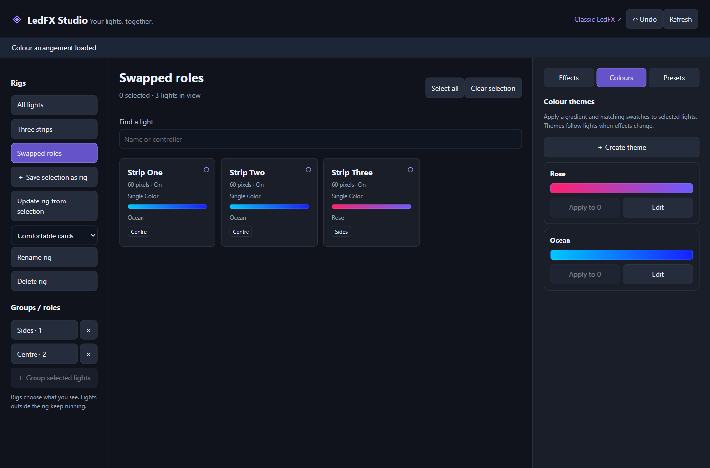

# LedFX Studio

**Select a rig, edit lights together, and save effects independently from colours.**

A Windows-focused personal fork of [LedFx](https://github.com/LedFx/LedFx),
extended by **Kit Leeming** with an alternative scene-building interface,
audio-reactive effects, Windows playback capture, and a portable app launcher.
The upstream LedFx engine and its contributors provide the foundation; the
custom additions described below are the focus of this repository.



*Screenshot uses dummy devices. It contains no personal controller configuration.*

## Why I built this

As my lighting setup grew, setting effects and colours one virtual at a time
became slow. Traditional scene snapshots also duplicated the same effects for
every colour scheme. Studio separates those decisions: save the effect arrangement
once, save colour arrangements independently, and pair either in named scenes.

## Custom additions

| Feature | What it does | Source |
| --- | --- | --- |
| Studio | Named devices, physical patch records, a measured stage and bulk effect/palette control | [UI source](studio-ui/), [state/transactions](ledfx/studio.py), [API](ledfx/api/studio.py) |
| Independent colour arrangements | Gradients with representative swatches, per-effect mapping, reusable roles and per-light overrides | [Studio guide](STUDIO.md) |
| Beat Scan | Each detected beat launches a new strip segment while earlier segments keep moving; speed follows audio energy | [Effect](ledfx/effects/beat_scan.py), [guide](BEAT_SCAN.md) |
| Wash effects | Six effects adapted for arrays of wash fixtures: Frequency Color, Band Conversation, Peak Ripple, Color Memory, Sonic Stream and Twinklecat | [Guide and design references](WASH_EFFECTS.md) |
| Windows playback capture | WASAPI loopback sources for playback devices, including Bluetooth headphones | [Adapter](ledfx/effects/windows_loopback.py) |
| Independent white/UV output | RGBW packet and device extensions for compatible WLED fixtures | [Portable build notes](PORTABLE_BUILD.md) |
| Portable launcher | Shortcut-friendly Windows executable; opens an app-style browser window and leaves the backend running when closed | [C# source](launcher/StudioLauncher.cs) |

Existing LedFx scenes remain in the classic interface. Rigs control the editing
view; they do not reconfigure controllers or turn off other rigs' lights.
Studio rejects overlapping virtuals instead of silently switching other outputs off.

## Status

Studio now uses four workspaces: **Devices, Patches, Stage, and Effects & palettes**.
The editor runs on the existing LedFX backend at `/studio/index.html`. See the
[Studio guide](STUDIO.md) for setup and the current hardware-control boundary.

This fork includes upstream LedFx **2.2.1**, the latest non-prerelease release
verified on **3 November 2026** (tag `v2.2.1`, commit
`e25a9b52f6d6503c2f4ff000414924ce8e110b66`). It is not an official LedFx release.
Only the stable tag was merged; unreleased upstream `main` was not imported.
The [upgrade record](UPSTREAM_REVIEW.md) describes retained custom paths and validation.

Source and build scripts are provided. **There is no prebuilt download attached
here yet.** The locally installed portable executable is intentionally excluded
from Git, together with dependencies, caches, device settings and backups.

The Studio/Beat Scan/wash tests cover software behaviour. Real audio timing,
network delivery and physical RGBW/UV output need checking with actual fixtures.

## Try it from source on Windows

Install Git, Python 3.12, uv and Node.js 20 or later. From PowerShell:

```powershell
git clone https://github.com/Kit-Leeming/LedFX-Studio.git
cd LedFX-Studio
uv sync --frozen --group dev --group build --python 3.12
npm --prefix frontend install --legacy-peer-deps
npm --prefix frontend run build:win32
Copy-Item frontend/build/* ledfx_frontend -Recurse -Force
uv run --no-sync python -m ledfx -c portable-data --open-ui
```

Open <http://127.0.0.1:8888/studio/index.html> for Studio; the root URL is the classic
interface. Configure your own controllers and audio source in the classic UI.
The frontend is included as ordinary source in this repo; no submodule setup is needed.

To build the desktop launcher and bundled backend:

```powershell
uv run --no-sync python -m PyInstaller --noconfirm windows-binary.spec
./Build-StudioLauncher.ps1
```

Run `LedFX Studio.exe` from the project root and create shortcuts to that file.
Keep the project folder together. The launcher uses the backend in `dist/LedFx`
and settings under `portable-data`. `Rebuild-LedFX.ps1` is the offline rebuild
helper for the original fully provisioned portable workspace; a fresh clone must
install its dependencies first using the commands above.

## Verification

```powershell
uv run --no-sync python -m unittest tests.test_studio
uv run --no-sync python -m pytest --noconftest tests/test_beat_scan.py tests/test_wash_inspired.py -q
```

The `--noconftest` flag avoids upstream's hardware/API integration fixtures for
these focused deterministic tests. Stable-upgrade validation also covers output
lifecycle, RGBW compatibility, E1.31 source ports, origin policy, audio selection
and Sendspin. See the upgrade record for the exact scope. See [architecture and source map](docs/STUDIO_ARCHITECTURE.md)
for a quick route through the code.

## Reading this repo with ChatGPT

Share this repository URL in your chat and ask about a specific feature or file.
If you use the GitHub integration, ensure its connected account is allowed to access
this repository. Publishing the code does not automatically add it to every chat's
context. The source map above and architecture guide are starting points for review.

## Credits and licensing

- [LedFx](https://github.com/LedFx/LedFx): upstream engine and project, GPL-3.0.
- [LedFx-Frontend-v2](https://github.com/YeonV/LedFx-Frontend-v2): frontend, AGPL-3.0.
- Custom fork changes: Kit Leeming, developed with AI-assisted coding and testing.

Licenses and upstream notices are retained. See [third-party notices](THIRD_PARTY_NOTICES.md),
[backend license](LICENSE.txt), [frontend license](frontend/LICENSE), and
[original upstream README](UPSTREAM_README.rst).
