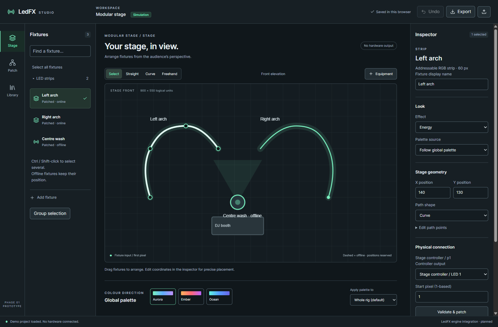
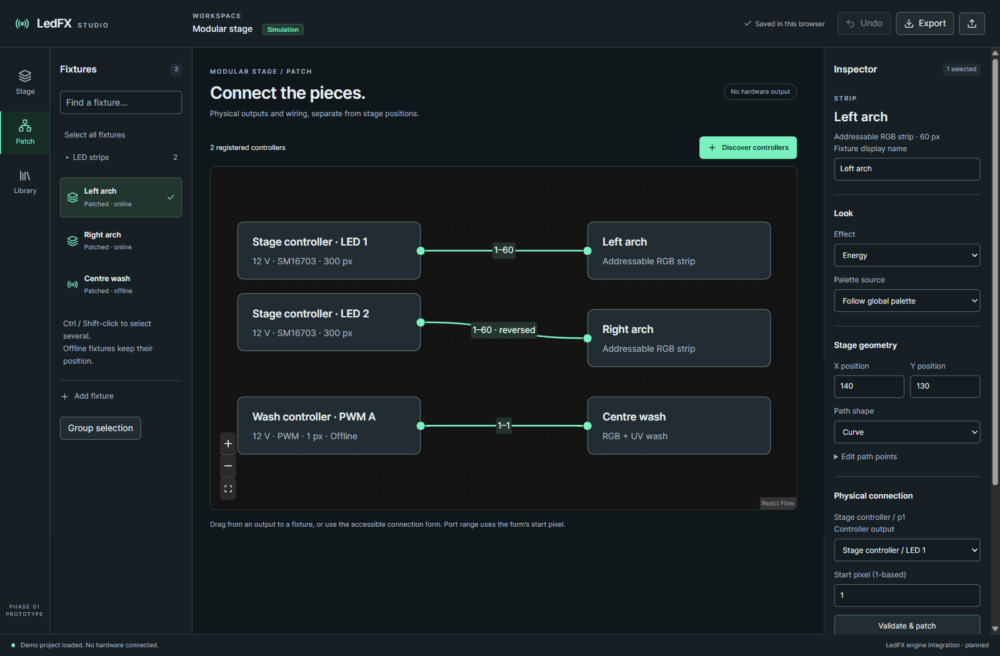

# Studio redesign · Phase 1

This is a **working, hardware-free design prototype**, not an installed Studio replacement. Source: [`studio-next/`](../../studio-next). Existing Studio files, scenes, `portable-data`, firmware and the installed executable are unchanged. The original Studio frontend remains in Git and on disk; no migration or cleanup has run.

## Try it

From `studio-next/`, with Node 20.19+ (or 22.12+):

```powershell
npm ci
npm run dev -- --port 5187 --strictPort
```

Open `http://localhost:5187`. For another device, use the host PC's LAN address and port 5187. The host must allow inbound access; no firewall changes are made by the prototype. The development server exposes only this demo, not LedFX control. Prefer the built preview for LAN review:

```powershell
npm run build
npm run preview -- --port 5187 --strictPort
```

After dependencies have been installed, building and running require no internet. All fonts, icons, React, Konva and React Flow are local; there are no CDNs, telemetry, remote assets, or hardware API calls. The browser must still reach the local host. This is not an installable/offline-cached PWA.

Project edits save in this browser's local storage, separately from LedFX. Export JSON to move the demo to another browser. Undo covers the current session's last 40 edits. Import is validated and undoable; an unreadable browser save is retained under the recovery key and can be exported from the inspector.

## Suggested walkthrough

1. **Patch → Discover controllers → Register** the simulated portable controller.
2. **Add fixture** → choose RGBW strip → create. Try patching it to the 12 V Stage controller: the app explains the voltage mismatch. Select the portable controller's 5 V SK6812 output and patch successfully.
3. **Stage** → select a strip. Drag it, change X/Y, draw a straight or curved path with clicks and Finish path, or drag a freehand path. Edit control points numerically as an alternative to dragging. Physical wiring remains unchanged.
4. Select the LED strips group, choose an effect, then choose a global palette. Give one fixture a local palette in the inspector. Change the global palette again: that override persists.
5. Select Centre wash. Set independent UV, then change a palette: UV remains unchanged. Its controller starts offline; its place stays reserved.
6. Simulate disconnection of a controller. Its fixtures remain in their places. Reconnect and confirm no redistribution.
7. **Library** → save a rig, an effect preset and a colour preset. Select both preset parts when saving a scene. Move a fixture, then load the rig to restore geometry. Load effect/colour presets independently.
8. **Profiles** → duplicate a template with a name, voltage and pixel count. Use it to create another fixture. Profile revisions are created as new profiles, so existing patched fixtures do not silently change.





## Deliverables

- [UX audit, alternatives and navigation](UX-REVIEW.md)
- [Architecture and proposed data contracts](ARCHITECTURE.md)
- [Evaluation evidence and prioritised production plan](EVALUATION.md)
- [Proposed TypeScript contracts](../../studio-next/src/contracts.ts)

## Checks

```powershell
npm test
npm run test:e2e
npm run build
```

Local browser tests use installed Microsoft Edge. CI uses Playwright Chromium (`npx playwright install --with-deps chromium`). A separate workflow builds and tests this prototype without starting the LedFX engine.

The prototype intentionally has a small simulated effect catalogue and palette library. It does not render audio, discover real devices, provision ports or verify electrical hardware. See the architecture proposal for the capability registry, apply transaction and engine adapters that must precede production hardware control.
